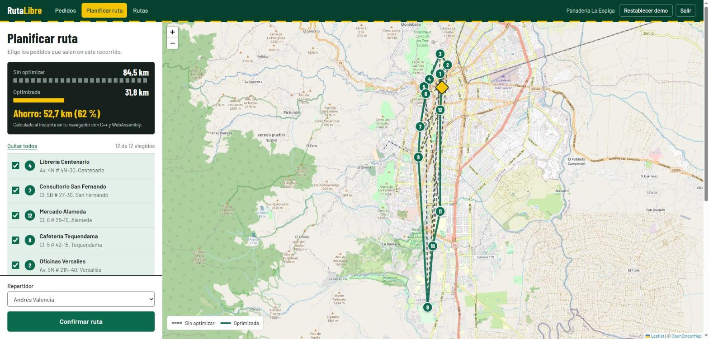
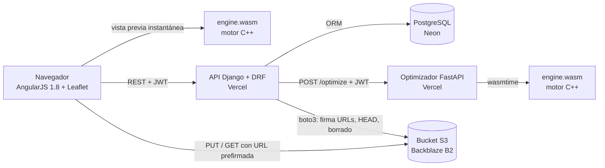

# RutaLibre

[](https://github.com/EstebanBautista/RutaLibre/actions/workflows/ci.yml)

Planificador de entregas para pequeños negocios. El negocio registra sus pedidos, elige cuáles salen hoy y RutaLibre calcula el orden de visita más corto con un motor escrito en **C++** y compilado a **WebAssembly**.

**Demo:** <https://rutalibre-chi.vercel.app> · pulsa **Entrar al demo**, sin registro. Entras a una panadería de Cali con 12 pedidos listos para planificar.



## Qué hace

1. **Pedidos:** se crean con cliente, dirección y una ubicación marcada en el mapa.
2. **Planificar ruta:** al elegir pedidos, el navegador ejecuta el motor C++ y muestra al instante la ruta en el orden de la lista contra la ruta optimizada, con los kilómetros ahorrados.
3. **Confirmar:** el backend Django pide el cálculo definitivo al servicio FastAPI, que ejecuta **el mismo motor** en el servidor, y guarda la ruta.
4. **Entregar:** en el detalle de la ruta se marca cada parada. La ruta pasa a "En curso" y luego a "Completada".
5. **Evidencia:** cada parada admite una foto. El navegador la reduce y la sube directo a un bucket compatible con S3 con una URL prefirmada; el backend la verifica antes de guardarla.

## Arquitectura



| Pieza | Tecnología | Carpeta | En producción |
|---|---|---|---|
| Motor de rutas | C++17 → WebAssembly (Emscripten) | [`engine/`](engine/) | dentro del frontend y del optimizador |
| Optimizador | FastAPI, Pydantic, wasmtime | [`optimizer/`](optimizer/) | <https://rutalibre-optimizer.vercel.app/docs> |
| API principal | Django 5.2, Django REST Framework, SimpleJWT | [`backend/`](backend/) | <https://rutalibre-api.vercel.app> |
| Interfaz | AngularJS 1.8, Leaflet, OpenStreetMap | [`frontend/`](frontend/) | <https://rutalibre-chi.vercel.app> |
| Base de datos | PostgreSQL | — | Neon (plan gratuito) |
| Fotos de evidencia | API S3 con `boto3` | [`backend/core/storage.py`](backend/core/storage.py) | Backblaze B2, bucket privado (plan gratuito) |

Cada push a `main` despliega los tres proyectos de Vercel automáticamente.

Más detalle en [`docs/architecture.md`](docs/architecture.md) y en las decisiones de [`docs/adr/`](docs/adr/).

## Requisitos de la vacante y dónde están

| Requisito | Dónde se ve en el proyecto |
|---|---|
| Python + Django: modelos, ORM, vistas, DRF | [`backend/core/models.py`](backend/core/models.py), [`views.py`](backend/core/views.py), [`serializers.py`](backend/core/serializers.py): viewsets filtrados por negocio, transacciones con `select_for_update`, anotaciones `Count` |
| AngularJS: controladores, servicios, consumo de APIs | [`frontend/js/`](frontend/js/): módulo con `ngRoute`, servicios (`AuthService`, `ApiService`, `MapService`, `EngineService`), interceptor HTTP para el JWT |
| FastAPI: APIs tipadas, validadas y documentadas | [`optimizer/app/`](optimizer/app/): modelos Pydantic con rangos, rechazo de `NaN`, ids únicos; OpenAPI en `/docs` |
| C++ | [`engine/src/route.cpp`](engine/src/route.cpp): haversine, vecino más cercano y 2-opt, sin memoria dinámica; exportado a WebAssembly y usado desde Python y JavaScript |
| AWS: S3 e IAM | **Código real:** [`core/storage.py`](backend/core/storage.py) y [`core/photos.py`](backend/core/photos.py) usan `boto3` con URLs prefirmadas PUT/GET, `HEAD` para validar, borrado por prefijo y CORS del bucket. Bucket privado y clave limitada a un bucket (mínimo privilegio, ver [política IAM equivalente](#camino-a-aws)). Corre contra Backblaze B2, compatible con S3 |
| AWS: EC2, RDS | Diseño en [Camino a AWS](#camino-a-aws); infraestructura como código en la fase B |
| Pruebas | 30 comprobaciones del motor, 27 tests del optimizador, 109 del backend (S3 simulado con `moto`), 17 del frontend |
| Revisión de código y CI | [GitHub Actions](.github/workflows/ci.yml): motor nativo y en wasm, optimizador con el wasm recién compilado, backend, frontend |
| Documentación técnica | Este README, [`docs/architecture.md`](docs/architecture.md), [ADRs](docs/adr/), [`docs/EXPLICACION.md`](docs/EXPLICACION.md) |

## Correrlo en local

Requisitos: Python 3.12 y Node 20 o superior. No hace falta Docker ni base de datos: en local se usa SQLite.

```bash
# 1. Optimizador (terminal 1)
cd optimizer
python -m venv .venv && .venv/Scripts/activate      # en Linux/macOS: source .venv/bin/activate
pip install -r requirements.txt uvicorn
uvicorn app.main:app --port 8001

# 2. Backend (terminal 2)
cd backend
python -m venv .venv && .venv/Scripts/activate
pip install -r requirements.txt
python manage.py migrate
python manage.py runserver 8000

# 3. Frontend (terminal 3): archivos estáticos, sin compilación
cd frontend
python -m http.server 5500
```

Abre <http://localhost:5500> y pulsa **Entrar al demo**. Las fotos de evidencia se activan solo si defines las variables `S3_*` de `backend/.env.example`; sin ellas, todo lo demás funciona igual. No hace falta configurar nada: sin variables de entorno, ambos servicios comparten una clave de desarrollo y aceptan peticiones desde `localhost:5500`. Las variables opcionales están en `backend/.env.example` y `optimizer/.env.example`.

### Tests

```bash
cd backend   && pytest           # 109 tests (S3 simulado con moto)
cd optimizer && pytest           # 27 tests
node --test "frontend/tests/*.mjs"
python engine/build.py --test    # requiere Emscripten
```

### Recompilar el motor C++

```bash
git clone https://github.com/emscripten-core/emsdk.git .tools/emsdk
cd .tools/emsdk && python emsdk.py install 7.0.0 && python emsdk.py activate 7.0.0 && cd ../..
python engine/build.py --test    # tests compilados a WebAssembly
python engine/build.py           # genera engine.wasm y lo copia a optimizer/ y frontend/
```

El `engine.wasm` compilado se versiona en el repositorio: así Vercel no necesita un compilador de C++. El CI lo recompila desde el código fuente y corre los tests contra ese binario nuevo.

## Camino a AWS

El demo corre en Vercel y Neon porque son gratuitos y no se apagan, y un portafolio tiene que estar disponible siempre. La arquitectura está pensada para moverse a AWS sin cambiar el código de negocio:

| Hoy | En AWS |
|---|---|
| Fotos en Backblaze B2 vía API S3 (`boto3`) | **S3**: cambian solo `S3_ENDPOINT_URL`, `S3_REGION` y las claves |
| Clave de B2 limitada a un bucket | Rol **IAM** con la política de abajo |
| Frontend estático en Vercel | **S3** + CloudFront |
| API Django y optimizador en Vercel Functions | **EC2** (o contenedores) detrás de un balanceador |
| PostgreSQL en Neon | **RDS** PostgreSQL; Django solo necesita otra `DATABASE_URL` |
| Variables secretas en Vercel | Secrets Manager |

Las fotos ya son código S3 real. Política IAM equivalente a los permisos que tiene hoy la clave de Backblaze (solo ese bucket, solo lo necesario):

```json
{
  "Version": "2012-10-17",
  "Statement": [
    {
      "Sid": "EvidencePhotos",
      "Effect": "Allow",
      "Action": ["s3:PutObject", "s3:GetObject", "s3:DeleteObject"],
      "Resource": "arn:aws:s3:::rutalibre-evidencias/*"
    },
    {
      "Sid": "ListForCleanupAndChecks",
      "Effect": "Allow",
      "Action": ["s3:ListBucket"],
      "Resource": "arn:aws:s3:::rutalibre-evidencias"
    }
  ]
}
```

EC2, RDS y el resto de roles son diseño; la fase B los lleva a Terraform.

## Hoja de ruta

- ~~**Fase A:** foto de evidencia al entregar con URL prefirmada vía `boto3`.~~ Hecha.
- **Fase B:** infraestructura AWS en Terraform (EC2, RDS, S3, IAM), validada en CI.
- **Fase C:** microservicio Flask de notificaciones al completar una ruta.
- **Fase D:** vista propia del repartidor, registro de usuarios, edición del depósito.
- **Fase E:** LocalStack para probar S3 e IAM en local.
- **Fase F:** distancias por carretera en lugar de línea recta.

## Limitaciones conocidas

- Las distancias son en línea recta (haversine), no por calles.
- La cuenta demo es compartida: cualquier visitante puede cambiar sus datos. Por eso existe **Restablecer demo** (que también borra sus fotos del bucket) y un tope de 200 pedidos.
- Las fotos de una ruta se ven con enlaces que vencen en 1 hora; recargar la página los renueva.
- El primer acceso tras un rato sin uso tarda un poco más: las funciones y la base de datos arrancan en frío.
