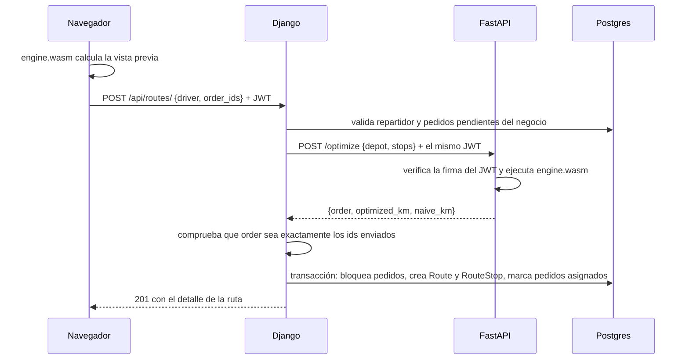
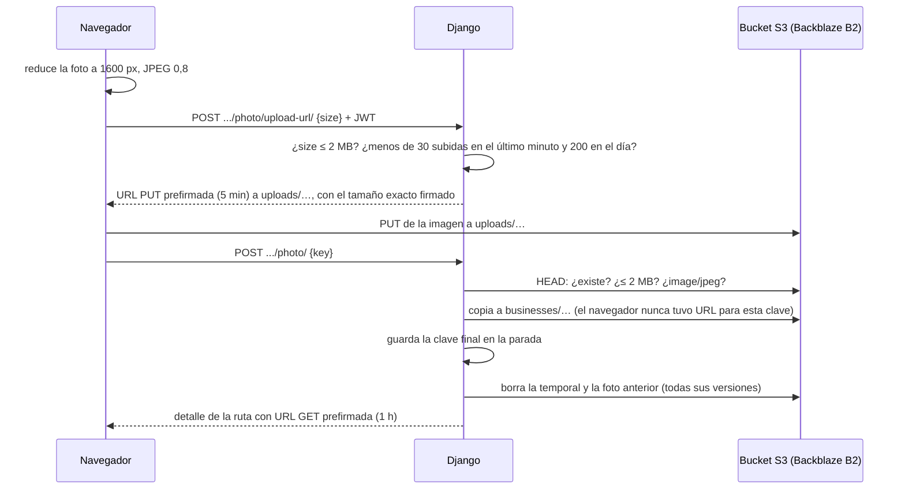

# Arquitectura de RutaLibre

## Piezas

```
rutalibre/
  engine/      Motor de rutas en C++17. Se compila a un único engine.wasm.
  optimizer/   FastAPI. Envuelve el motor y expone POST /optimize.
  backend/     Django + DRF. Datos, autenticación y orquestación.
  frontend/    AngularJS 1.8 estático. Usa el motor para la vista previa.
```

Cada carpeta de servicio (`optimizer`, `backend`, `frontend`) es un proyecto de Vercel independiente con su propio "Root Directory".

## El motor C++ y por qué es un solo binario

`engine/src/route.cpp` implementa:

- **Haversine:** distancia en km entre dos coordenadas sobre una esfera de radio 6371,0088 km.
- **Matriz de distancias** entre el depósito y las paradas.
- **Vecino más cercano:** desde el depósito, ir siempre a la parada no visitada más cercana. Da una ruta razonable pero con cruces.
- **2-opt:** tomar dos tramos del circuito (a→b y c→d). Si unir a→c y b→d es más corto, invertir el trozo b…c. Repetir hasta que ninguna inversión mejore. Elimina los cruces.

El motor no usa memoria dinámica: trabaja con arreglos estáticos para hasta 100 paradas. Gracias a eso el `.wasm` no importa nada del entorno (ni `malloc` ni WASI) y carga igual en un navegador que en Python.

La comunicación con el módulo es por memoria compartida:

1. El anfitrión pide la dirección del buffer `rl_coords()` y escribe `[lat_depósito, lng_depósito, lat_0, lng_0, …]` como `double`.
2. Llama `rl_optimize(n)`, que devuelve los km del circuito optimizado y escribe el orden en `rl_order()`.
3. Lee `n` enteros de `rl_order()`.

El mismo binario lo usan [`optimizer/app/engine.py`](../optimizer/app/engine.py) (con `wasmtime`) y [`frontend/js/engine-loader.js`](../frontend/js/engine-loader.js) (con la API `WebAssembly` del navegador). Un test del frontend comprueba que ambos dan exactamente el mismo resultado.

## Flujo "crear ruta"



Puntos de diseño:

- **Django llama al optimizador fuera de la transacción.** No se retienen bloqueos de la base de datos mientras se espera la red. Dentro de la transacción se vuelven a comprobar los pedidos con `select_for_update`, por si otra petición los tomó mientras tanto.
- **El servidor no confía en el navegador.** La vista previa es solo informativa; la ruta guardada sale del cálculo del servidor.
- **Fallos del optimizador** (caída, timeout de 10 s, respuesta inválida) se convierten en un 502 con un mensaje claro, y no se guarda nada.

## Fotos de evidencia (S3 con URLs prefirmadas)

La foto nunca pasa por Django: va del navegador al bucket.



- **Dos zonas en el bucket.** El navegador solo escribe en `uploads/{negocio}/…`. Las fotos confirmadas viven en `businesses/{negocio}/…`, adonde solo copia el servidor. Así una foto ya validada no se puede sobrescribir con la URL de subida, que sigue vigente unos minutos.
- **El tamaño va dentro de la firma.** El navegador declara cuántos bytes subirá y el servidor lo firma como `Content-Length`; Backblaze rechaza con 403 cualquier cuerpo de otro tamaño. Sin esto, una URL prefirmada acepta hasta 5 GB.
- **Límite de subidas por negocio:** 30 por minuto y 200 por día, contadas en la tabla `UploadGrant` (no en memoria: Vercel corre varias instancias). En el peor caso, 400 MB al día. El reset del demo no borra ese historial.
- **Limpieza automática:** una regla de ciclo de vida del bucket elimina lo que quede en `uploads/` tras un día (subidas nunca confirmadas).
- **Borrar de verdad.** Backblaze guarda versiones: un borrado simple solo oculta el archivo y el espacio sigue ocupado. `storage.delete` y `delete_prefix` eliminan cada versión y cada marcador.
- **El servidor elige la clave** y al confirmar exige el prefijo exacto de la parada: nadie puede adjuntar un objeto de otra parada o de otro negocio.
- **El bucket es privado.** Leer una foto exige una URL firmada que vence.
- **CORS del bucket:** solo `PUT` y `GET` desde el frontend desplegado y `localhost:5500`. Otros orígenes reciben 403.
- **Checksums:** `boto3` reciente añade una cabecera CRC32 a las subidas firmadas que Backblaze rechaza; el cliente se configura con `request_checksum_calculation="when_required"`.
- **Fallas aisladas:** si el bucket no responde, pedir o confirmar una foto da 502, pero entregar y ver la ruta siguen funcionando. Sin variables `S3_*`, las fotos se desactivan y el botón no aparece.
- **Restablecer demo** borra las dos zonas del negocio demo (`businesses/` y `uploads/`), con todas sus versiones.

## Autenticación

- Django emite JWT HS256 con `djangorestframework-simplejwt` (acceso de 12 h).
- El frontend guarda el token en `localStorage` y un interceptor HTTP lo añade a cada llamada. Ante un 401, borra la sesión y vuelve al login.
- FastAPI verifica el mismo token con la clave compartida `JWT_SIGNING_KEY` y exige `token_type == "access"`. No consulta la base de datos.
- La cuenta demo no tiene contraseña utilizable: solo se entra por `POST /api/auth/demo/`.

## Aislamiento entre negocios

Todo viewset hereda de `BusinessScopedMixin`, que filtra el queryset por el negocio del usuario. Un registro de otro negocio simplemente no existe para ese usuario: la respuesta es 404, nunca 403. Así no se filtra ni siquiera su existencia.

## Despliegue

| Servicio | Proyecto Vercel | Variables |
|---|---|---|
| Frontend | `rutalibre` | ninguna (URLs en `frontend/js/config.js`) |
| API | `rutalibre-api` | `DATABASE_URL`, `DJANGO_SECRET_KEY`, `JWT_SIGNING_KEY`, `OPTIMIZER_URL`, `CORS_ALLOWED_ORIGINS`, `S3_ENDPOINT_URL`, `S3_REGION`, `S3_BUCKET`, `S3_ACCESS_KEY_ID`, `S3_SECRET_ACCESS_KEY` |
| Optimizador | `rutalibre-optimizer` | `JWT_SIGNING_KEY`, `CORS_ALLOWED_ORIGINS` |

Cada push a `main` despliega solo, así que una migración se aplica a Neon **antes** del push. Las migraciones y los datos demo se aplican contra Neon desde una máquina local (`python manage.py migrate` y `seed_demo` con `DATABASE_URL` en `backend/.env.local`). De todos modos, el login demo crea los datos si faltan.

## Infraestructura como código (AWS)

[`infra/terraform/`](../infra/terraform/) describe el mismo sistema en AWS. Está **validado en el CI, no aplicado**: el demo sigue en Vercel. Detalle, costo y límites en [`infra/README.md`](../infra/README.md); la decisión en el [ADR 0005](adr/0005-terraform-validado-sin-aplicar.md).

| Hoy | En AWS (Terraform) | Módulo |
|---|---|---|
| Frontend en Vercel | S3 privado detrás de CloudFront | `storage`, `edge` |
| Django y FastAPI en Vercel Functions | Una EC2 con nginx, gunicorn y uvicorn | `compute` |
| Neon | RDS PostgreSQL en subredes privadas | `database`, `network` |
| Backblaze B2 con clave limitada a un bucket | S3 con un rol IAM de instancia | `storage`, `compute` |
| Variables secretas de Vercel | Parameter Store y Secrets Manager | `compute` |

Decisiones de seguridad:

- **Base de datos privada.** Sin IP pública, en subredes sin ruta a internet, y el puerto 5432 abierto solo al grupo de seguridad de la aplicación.
- **Sin SSH.** La EC2 no tiene par de claves ni puerto 22; se administra con Session Manager. Solo CloudFront llega a su puerto 80.
- **IAM mínimo.** El rol de la instancia tiene tres políticas separadas por propósito; la de fotos lista exactamente las 6 acciones S3 que usa `storage.py`.
- **Secretos fuera de Terraform.** RDS genera y guarda su contraseña; las claves de Django van en Parameter Store. Ningún secreto aparece en el código ni en el estado.

Verificación sin cuenta de AWS: `terraform fmt`, `validate`, TFLint, `terraform test` con el proveedor simulado, `shellcheck` y Checkov.
