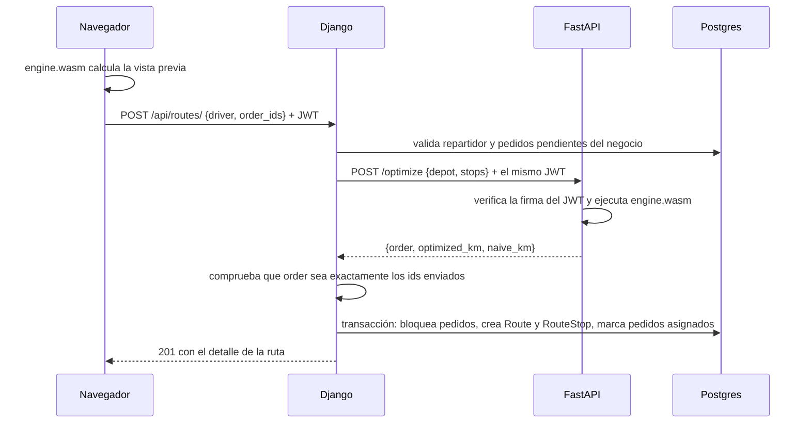

# Arquitectura de RutaLibre

## Piezas

```
rutalibre/
  engine/      Motor de rutas en C++17. Se compila a un único engine.wasm.
  optimizer/   FastAPI. Envuelve el motor y expone POST /optimize.
  backend/     Django + DRF. Datos, autenticación y orquestación.
  frontend/    AngularJS 1.8 estático. Usa el motor para la vista previa.
```

Cada carpeta de servicio (`optimizer`, `backend`, `frontend`) es un proyecto de Vercel independiente con su propio "Root Directory".

## El motor C++ y por qué es un solo binario

`engine/src/route.cpp` implementa:

- **Haversine:** distancia en km entre dos coordenadas sobre una esfera de radio 6371,0088 km.
- **Matriz de distancias** entre el depósito y las paradas.
- **Vecino más cercano:** desde el depósito, ir siempre a la parada no visitada más cercana. Da una ruta razonable pero con cruces.
- **2-opt:** tomar dos tramos del circuito (a→b y c→d). Si unir a→c y b→d es más corto, invertir el trozo b…c. Repetir hasta que ninguna inversión mejore. Elimina los cruces.

El motor no usa memoria dinámica: trabaja con arreglos estáticos para hasta 100 paradas. Gracias a eso el `.wasm` no importa nada del entorno (ni `malloc` ni WASI) y carga igual en un navegador que en Python.

La comunicación con el módulo es por memoria compartida:

1. El anfitrión pide la dirección del buffer `rl_coords()` y escribe `[lat_depósito, lng_depósito, lat_0, lng_0, …]` como `double`.
2. Llama `rl_optimize(n)`, que devuelve los km del circuito optimizado y escribe el orden en `rl_order()`.
3. Lee `n` enteros de `rl_order()`.

El mismo binario lo usan [`optimizer/app/engine.py`](../optimizer/app/engine.py) (con `wasmtime`) y [`frontend/js/engine-loader.js`](../frontend/js/engine-loader.js) (con la API `WebAssembly` del navegador). Un test del frontend comprueba que ambos dan exactamente el mismo resultado.

## Flujo "crear ruta"



Puntos de diseño:

- **Django llama al optimizador fuera de la transacción.** No se retienen bloqueos de la base de datos mientras se espera la red. Dentro de la transacción se vuelven a comprobar los pedidos con `select_for_update`, por si otra petición los tomó mientras tanto.
- **El servidor no confía en el navegador.** La vista previa es solo informativa; la ruta guardada sale del cálculo del servidor.
- **Fallos del optimizador** (caída, timeout de 10 s, respuesta inválida) se convierten en un 502 con un mensaje claro, y no se guarda nada.

## Autenticación

- Django emite JWT HS256 con `djangorestframework-simplejwt` (acceso de 12 h).
- El frontend guarda el token en `localStorage` y un interceptor HTTP lo añade a cada llamada. Ante un 401, borra la sesión y vuelve al login.
- FastAPI verifica el mismo token con la clave compartida `JWT_SIGNING_KEY` y exige `token_type == "access"`. No consulta la base de datos.
- La cuenta demo no tiene contraseña utilizable: solo se entra por `POST /api/auth/demo/`.

## Aislamiento entre negocios

Todo viewset hereda de `BusinessScopedMixin`, que filtra el queryset por el negocio del usuario. Un registro de otro negocio simplemente no existe para ese usuario: la respuesta es 404, nunca 403. Así no se filtra ni siquiera su existencia.

## Despliegue

| Servicio | Proyecto Vercel | Variables |
|---|---|---|
| Frontend | `rutalibre` | ninguna (URLs en `frontend/js/config.js`) |
| API | `rutalibre-api` | `DATABASE_URL`, `DJANGO_SECRET_KEY`, `JWT_SIGNING_KEY`, `OPTIMIZER_URL`, `CORS_ALLOWED_ORIGINS` |
| Optimizador | `rutalibre-optimizer` | `JWT_SIGNING_KEY`, `CORS_ALLOWED_ORIGINS` |

Las migraciones y los datos demo se aplican contra Neon desde una máquina local (`python manage.py migrate` y `seed_demo` con `DATABASE_URL` en `backend/.env.local`). De todos modos, el login demo crea los datos si faltan.
