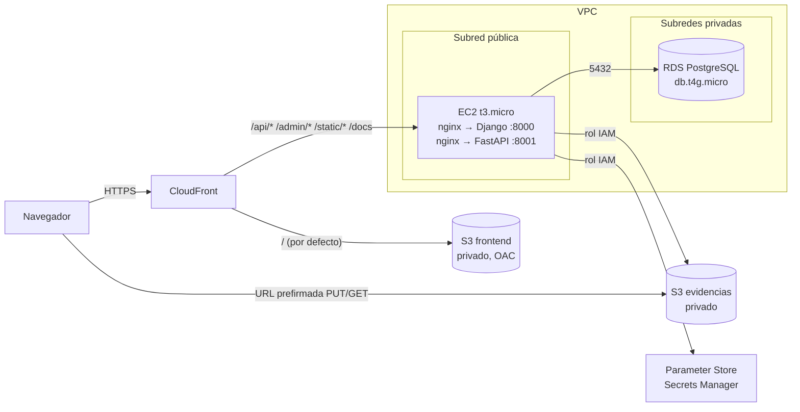

# Fase B — Infraestructura AWS en Terraform, validada sin aplicarse

Fecha: 2026-11-14
Estado: aprobado por Esteban (2026-11-15)

## Intención

La vacante pide AWS: EC2, S3, RDS e IAM. Hoy RutaLibre tiene S3 e IAM como código real (Fase A)
y EC2 y RDS solo como una tabla en el README. Esta fase escribe la infraestructura completa de
RutaLibre en AWS como código Terraform y demuestra que es correcta **sin crear nada en AWS**:
formato, validación de esquema, linter, tests con el proveedor simulado y análisis de seguridad,
todo en el CI.

El demo sigue en Vercel, Neon y Backblaze. Nada de esta fase cambia lo desplegado.

## Objetivos

- Terraform que describe RutaLibre en AWS con los cuatro servicios de la vacante: EC2, RDS, S3, IAM.
- Verificación automática en cada push, sin cuenta ni credenciales de AWS.
- Tests que fijan las propiedades de seguridad (base de datos privada, bucket privado, IAM de
  mínimo privilegio), no solo que "compila".
- Costo $0: nunca se ejecuta `terraform apply`.
- Documentación honesta: qué está validado, qué no, cuánto costaría y qué faltaría para aplicarlo.

## No-objetivos

- Aplicar la infraestructura o crear una cuenta de AWS.
- Cambiar el código de la aplicación (backend, optimizador, frontend).
- Alta disponibilidad: Multi-AZ, autoescalado, balanceador, WAF.
- Dominio propio y certificado ACM.
- Pipeline de despliegue a AWS (rol OIDC de GitHub, `aws s3 sync`).
- Contenedores (ECS, Docker).

## Anti-objetivos

- Presentar la infraestructura como "desplegada" o "probada en AWS". Está validada, no aplicada.
- Secretos en archivos `.tf`, en el estado o en el repositorio.
- Silenciar hallazgos del análisis de seguridad sin una razón escrita junto al recurso.
- Tests que pasan aunque se rompa la propiedad que dicen proteger.
- Que el job nuevo vuelva lento o inestable el CI actual.

## Restricciones

- Sin cuenta de AWS: todo lo que se ejecute debe funcionar sin credenciales.
- Terraform no está instalado. Se instala en `I:\proyecto_trabajo\.tools\` (el disco C está al 95 %).
- Versiones leídas de las páginas de releases el 2026-11-14: Terraform 1.17.2, proveedor AWS
  6.73.0, TFLint 0.66.0 con `tflint-ruleset-aws` 0.50.0, Checkov 3.4.5,
  `hashicorp/setup-terraform@v4`, `terraform-linters/setup-tflint@v6`.
- Código y comentarios en inglés; documentación en español (como el resto del repositorio).

## Enfoques considerados

### Alcance

| Enfoque | Ventaja | Costo | Decisión |
|---|---|---|---|
| **A. Sistema completo:** red, EC2, RDS, dos buckets S3, IAM y CloudFront como entrada HTTPS | Es un diseño que podría aplicarse: tiene HTTPS, frontend y API en el mismo origen | CloudFront no está en la vacante; un módulo más que estudiar | **Elegido** (decisión de Claude) |
| B. Solo los cuatro servicios: EC2 con nginx sirve todo, sin CloudFront | Menos código | Sin HTTPS salvo comprando un dominio; el JWT viajaría en claro. Un revisor lo nota | Descartado |
| C. EC2 + RDS + IAM, frontend y fotos fuera | Mínimo | Deja fuera S3, que es lo que ya es código real | Descartado |

### Cómo demostrar que es correcta sin aplicarla

| Enfoque | Qué prueba | Decisión |
|---|---|---|
| `terraform fmt` + `validate` | Sintaxis y esquema real del proveedor | Incluido |
| TFLint con reglas de AWS | Tipos de instancia inexistentes, variables sin usar, convenciones | Incluido |
| `terraform test` con `mock_provider "aws"` | Propiedades concretas del plan (BD no pública, acciones IAM exactas) sin credenciales | Incluido: es el equivalente a los tests del resto del proyecto |
| Checkov | Malas prácticas de seguridad conocidas | Incluido, con excepciones justificadas en línea |
| LocalStack (`apply` contra un AWS simulado) | Más cercano a un `apply` real | Descartado aquí: exige Docker y RDS/CloudFront no están en su versión gratuita. La fase E lo cubre para S3 e IAM |
| Cuenta AWS real con créditos | Lo único que prueba el `apply` de verdad | Descartado: pide tarjeta y los créditos vencen |

### Organización

Módulos pequeños por responsabilidad (`network`, `storage`, `database`, `compute`, `edge`) y un
módulo raíz que los conecta. Un solo archivo sería más corto pero no permite probar cada parte
por separado ni estudiarlas una a una.

## Diseño

### Arquitectura en AWS

Región `us-east-1`. Nombres con prefijo `rutalibre-prod`.

### Módulos

**`network`** — VPC `10.20.0.0/16`. Dos subredes públicas (`10.20.0.0/24`, `10.20.1.0/24`) y dos
privadas (`10.20.10.0/24`, `10.20.11.0/24`) en `us-east-1a` y `us-east-1b` (RDS exige dos zonas
para su grupo de subredes). Internet Gateway y ruta por defecto solo en las públicas. **Sin NAT
Gateway** (cuesta unos US$32 al mes y la base de datos no necesita salir a internet). El grupo de
seguridad por defecto de la VPC queda sin reglas.

**`storage`** — Dos buckets privados, con bloqueo de acceso público, cifrado SSE-S3, versiones y
política que niega peticiones sin TLS.
- *Evidencias:* reproduce lo que hoy tiene Backblaze. CORS solo `PUT` y `GET` desde el origen del
  frontend. Ciclo de vida: `uploads/` expira en 1 día, versiones no vigentes expiran en 1 día,
  subidas multiparte incompletas se abortan en 1 día.
- *Frontend:* los archivos estáticos. Solo CloudFront puede leerlo.

**`database`** — RDS PostgreSQL 17, `db.t4g.micro`, 20 GB gp3 cifrados, en las subredes privadas,
`publicly_accessible = false`. Su grupo de seguridad acepta el puerto 5432 **solo** desde el grupo
de seguridad de la aplicación. La contraseña la genera y guarda RDS en Secrets Manager
(`manage_master_user_password`): no aparece en el código ni en el estado. Copias de 7 días,
protección contra borrado, snapshot final, TLS obligatorio (`rds.force_ssl`).

**`compute`** — Una instancia EC2 `t3.micro` con Amazon Linux 2023 en una subred pública, con IP
elástica.
- Sin SSH: no hay par de claves ni puerto 22. Se administra con SSM Session Manager.
- IMDSv2 obligatorio, disco raíz cifrado.
- Grupo de seguridad: entra solo el puerto 80 y solo desde la lista de prefijos de CloudFront.
- **Rol IAM** de la instancia, con tres políticas en línea separadas por propósito:
  - `evidence-photos`: sobre los objetos del bucket de evidencias `s3:PutObject`, `s3:GetObject`,
    `s3:DeleteObject`, `s3:DeleteObjectVersion`; sobre el bucket `s3:ListBucket`,
    `s3:ListBucketVersions`. Son exactamente las llamadas de `backend/core/storage.py`.
  - `read-config`: leer parámetros bajo `/rutalibre/prod/`.
  - `read-db-secret`: leer solo el secreto de la contraseña de RDS.
  - Más la política administrada `AmazonSSMManagedInstanceCore`.
- `bootstrap.sh` (user data): instala Python, nginx y git, clona el repositorio, crea los
  servicios systemd de gunicorn (Django) y uvicorn (optimizador) y configura nginx. El optimizador
  escucha solo en `127.0.0.1`: Django lo llama por la red local y de internet solo se publican
  `/docs` y `/openapi.json`.

**`edge`** — Distribución CloudFront con el dominio `*.cloudfront.net` (HTTPS gratis, sin dominio
propio). Origen por defecto: bucket del frontend con Origin Access Control. Rutas `/api/*`,
`/admin/*`, `/static/*`, `/docs`, `/openapi.json` van a la EC2 sin caché. Todo redirige a HTTPS.
Aquí vive también la política del bucket del frontend que autoriza a esta distribución.

**Raíz** — conecta los módulos. Sin backend remoto configurado; `backend.tf.example` muestra el
backend S3 con bloqueo nativo que se usaría.

### Secretos

Terraform no crea ni conoce valores secretos. `DJANGO_SECRET_KEY` y `JWT_SIGNING_KEY` los cargaría
un operador una vez en Parameter Store (`SecureString`); el rol de la instancia solo puede leerlos.
La contraseña de la base de datos la administra RDS.

### Verificación (job nuevo del CI: "Infraestructura (Terraform)")

1. `terraform fmt -check -recursive`
2. `terraform init -backend=false -lockfile=readonly` y `terraform validate`
3. `tflint --recursive`
4. `terraform test` (proveedor AWS simulado; ninguna credencial)
5. `shellcheck` sobre `bootstrap.sh`
6. `checkov`

### Qué fijan los tests

| Módulo | Propiedades |
|---|---|
| `network` | 2 subredes públicas y 2 privadas, en las dos zonas, con los CIDR indicados; ninguna asigna IP pública automática. El grupo de seguridad por defecto sin reglas lo comprueba Checkov |
| `storage` | Ambos buckets: 4 bloqueos de acceso público, versiones activas, cifrado. Evidencias: CORS exactamente `PUT` y `GET` desde el origen dado; `uploads/` expira en 1 día |
| `database` | No pública, cifrada, contraseña administrada (ninguna en el código), protección contra borrado, 5432 solo desde el grupo de la aplicación y nunca desde un CIDR |
| `compute` | IMDSv2, disco cifrado, la regla de entrada es el puerto 80 y nunca desde un CIDR, conjunto **exacto** de acciones y recursos de la política `evidence-photos`. "Sin par de claves" se comprueba por búsqueda de texto: ese atributo es desconocido durante el plan |
| `edge` | Todas las rutas redirigen a HTTPS; `/api/*` va al origen EC2; el frontend es el origen por defecto |
| raíz | El conjunto completo produce un plan |

### Excepciones del análisis de seguridad

Checkov marcará prácticas que cuestan dinero o añaden servicios fuera del alcance (Multi-AZ,
monitoreo detallado, WAF, registros de acceso, claves KMS propias, replicación entre regiones,
registros de flujo de la VPC). Regla: si el hallazgo se corrige sin costo y sin añadir un servicio,
se corrige. Si no, se exceptúa **en línea, junto al recurso, con la razón**. No hay lista global de
exclusiones. `infra/README.md` resume todas las excepciones en una tabla.

### Lo que se dice con honestidad

`infra/README.md` incluye:
- **Validado / no validado.** Los tests usan un proveedor simulado: prueban la configuración, no
  que AWS la acepte. `bootstrap.sh` nunca se ha ejecutado.
- **Qué falta para aplicarla de verdad:** que `settings.py` reconozca producción fuera de Vercel
  (hoy usa `VERCEL=1`); que `storage.py` acepte credenciales del rol en vez de exigir claves
  estáticas; que `frontend/js/config.js` use el mismo origen; subir el frontend al bucket; correr
  migraciones.
- **Límites de los tests:** los identificadores que calcula AWS se fijan con `override_resource`
  para probar el cableado entre módulos (cambio tras la revisión final); `ALLOWED_HOSTS` depende del
  dominio de CloudFront, que solo existe tras un primer `apply`, y lo pone un operador.
- **Costo estimado** si se aplicara (del orden de US$25–30 al mes; se verifica con la calculadora
  de AWS durante la implementación).

### Documentación del repositorio

- README: la fila "AWS: EC2, RDS" pasa de "diseño" a "Terraform validado en CI, no aplicado"; la
  política IAM se corrige (hoy le faltan `s3:ListBucketVersions` y `s3:DeleteObjectVersion`, que el
  código usa desde la revisión final de la Fase A); hoja de ruta y lista de jobs del CI.
- `docs/architecture.md`: sección "Infraestructura como código".
- `docs/adr/0005-terraform-validado-sin-aplicar.md`.
- `docs/EXPLICACION.md`: sección 9 con preguntas de estudio.

## Decisiones del diseñador (Claude)

- CloudFront incluido como entrada HTTPS.
- Terraform y no OpenTofu: es el nombre que reconoce un reclutador. El código es compatible.
- Checkov y no Trivy.
- EC2 x86 (`t3.micro`) y no ARM: evita dudas con las ruedas de `wasmtime`.
- Sin NAT Gateway; EC2 en subred pública protegida por su grupo de seguridad.
- Secretos fuera de Terraform.
- Políticas IAM con `jsonencode` y ARN construidos a partir de nombres, para que los tests puedan
  leer su contenido durante el plan.
- No tocar el código de la aplicación en esta fase.

## Lo que queda al constructor

- Nombres de recursos internos y de variables secundarias.
- Identificadores exactos de las reglas de Checkov a exceptuar (salen de ejecutarlo).
- Contenido detallado de `bootstrap.sh` y de la configuración de nginx.
- Cabeceras CORS exactas del bucket (copiar las vigentes en Backblaze: `.tools/scripts/b2_cors.py`).
