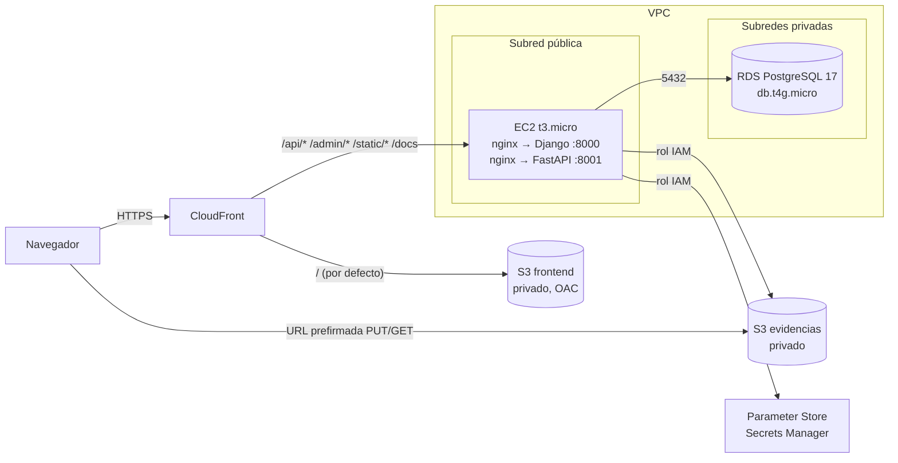

# Infraestructura AWS (Terraform)

RutaLibre descrito en AWS como código: red, servidor EC2, base de datos RDS, buckets S3, roles IAM y CloudFront.

**Estado: validado, no aplicado.** El demo público corre en Vercel, Neon y Backblaze B2 porque son gratuitos y no se apagan. Esta carpeta muestra cómo correría en AWS y el CI comprueba en cada push que la configuración es correcta, **sin cuenta de AWS, sin credenciales y sin crear nada**.

## Diagrama



## Módulos

| Módulo | Qué crea |
|---|---|
| [`network`](terraform/modules/network/) | VPC `10.20.0.0/16`, 2 subredes públicas y 2 privadas en `us-east-1a`/`us-east-1b`. Sin NAT Gateway. El grupo de seguridad por defecto queda sin reglas. |
| [`storage`](terraform/modules/storage/) | Bucket de evidencias (CORS para URLs prefirmadas, `uploads/` expira en 1 día, versiones viejas en 1 día) y bucket del frontend. Ambos privados, cifrados y con versiones. |
| [`database`](terraform/modules/database/) | RDS PostgreSQL en subredes privadas. Contraseña generada y guardada por RDS en Secrets Manager. TLS obligatorio. Solo acepta conexiones del grupo de seguridad de la aplicación. |
| [`compute`](terraform/modules/compute/) | EC2 sin clave SSH ni puerto 22 (se administra con Session Manager), IMDSv2, disco cifrado. Rol IAM con tres políticas mínimas. [`bootstrap.sh`](terraform/modules/compute/files/bootstrap.sh) instala la aplicación. |
| [`edge`](terraform/modules/edge/) | CloudFront: HTTPS con el certificado gratuito de `*.cloudfront.net`, cabeceras de seguridad, el frontend desde S3 y la API desde la EC2. |

La política IAM del bucket de evidencias tiene exactamente las acciones que usa [`backend/core/storage.py`](../backend/core/storage.py):

| Recurso | Acciones |
|---|---|
| `arn:aws:s3:::rutalibre-evidencias/*` | `s3:PutObject`, `s3:GetObject`, `s3:DeleteObject`, `s3:DeleteObjectVersion` |
| `arn:aws:s3:::rutalibre-evidencias` | `s3:ListBucket`, `s3:ListBucketVersions` |

## Cómo se verifica

El job **Infraestructura (Terraform)** del [CI](../.github/workflows/ci.yml) ejecuta:

| Paso | Qué prueba |
|---|---|
| `terraform fmt -check` | Formato estándar |
| `terraform validate` | Sintaxis y esquema real del proveedor AWS 6.x |
| TFLint + reglas AWS | Tipos de instancia inexistentes, variables sin usar, convenciones |
| `terraform test` | 8 escenarios con el proveedor AWS **simulado** (`mock_provider`): propiedades concretas del plan |
| Búsqueda de texto | Ningún `key_name` ni `aws_key_pair`: la EC2 no tiene clave SSH |
| `shellcheck` | El script de arranque |
| Checkov | Malas prácticas de seguridad conocidas; falla ante cualquier hallazgo nuevo |

En local (con las herramientas en `.tools/`, como en el CI):

```bash
cd infra/terraform
terraform init -backend=false
terraform fmt -check -recursive
terraform validate
tflint --init && tflint --recursive --config "$(pwd)/.tflint.hcl"
terraform test
shellcheck modules/compute/files/bootstrap.sh
checkov -d . --framework terraform --compact --quiet
```

### Qué fijan los tests

| Test | Propiedades |
|---|---|
| `network` | 2 + 2 subredes con los CIDR y zonas indicados; ninguna asigna IP pública automática; las privadas usan la tabla de rutas sin salida a internet |
| `storage` | Ambos buckets: 4 bloqueos de acceso público, versiones, cifrado, sin ACL. Evidencias: CORS solo `PUT` y `GET` desde el origen dado; `uploads/` expira en 1 día; se niega todo acceso sin TLS. Frontend: versiones viejas expiran en 30 días |
| `database` | No pública, cifrada, contraseña administrada (ninguna en el código), protección contra borrado, backups de 7 días, 5432 solo desde el grupo de la aplicación y nunca desde un CIDR, `rds.force_ssl`, registros de PostgreSQL |
| `compute` | `t3.micro`, IMDSv2, disco cifrado, puerto 80 solo desde la lista de prefijos de CloudFront; acciones y recursos **exactos** de la política de fotos, sin comodines; lectura de parámetros limitada a `/rutalibre/prod`; Session Manager; el temporizador que refresca la contraseña rotada; nginx y Django aceptan solo el dominio de esta distribución |
| `edge` | HTTPS en todas las rutas; las 5 rutas de API van a la EC2 y le pasan la cabecera `Host`; el frontend es el origen por defecto y se lee con OAC; solo esta distribución puede leer el bucket del frontend y se niega todo acceso sin TLS; cabeceras de seguridad |
| `stack` | El módulo raíz completo produce un plan, y el cableado entre módulos es seguro: la base de datos recibe solo las subredes privadas y solo el grupo de seguridad de la aplicación; la EC2 va en una subred pública |

Las propiedades principales se comprobaron rompiéndolas a propósito (por ejemplo, poner `publicly_accessible = true`, añadir `s3:*` o pasar las subredes públicas a la base de datos) y viendo fallar el test.

## Qué no está validado

- **Los tests usan un proveedor simulado.** Prueban la configuración que Terraform enviaría, no que AWS la acepte. Un `apply` real podría encontrar errores que el plan no ve (cuotas, nombres de bucket ya tomados, combinaciones que la API rechaza).
- **`bootstrap.sh` nunca se ejecutó** en una instancia real. Pasa `bash -n` y `shellcheck`, nada más.
- **Los identificadores que asigna AWS** (subredes, grupos de seguridad) se fijan con `override_resource` en los tests: así se prueba a qué módulo llega cada uno, pero no los valores reales.
- **El dominio de CloudFront** llega al servidor (nginx y `ALLOWED_HOSTS`) y al CORS del bucket en el mismo `apply`. Para eso la IP elástica se crea aparte y se asocia después a la instancia; atarla a la instancia crearía un ciclo (lo detecta `terraform validate`).

## Qué faltaría para aplicarlo de verdad

1. **Código de la aplicación** (esta fase no lo toca):
   - Django se conecta con el usuario maestro de RDS. Lo correcto sería un usuario propio de la aplicación, sin permisos de administración.
   - `backend/config/settings.py` reconoce producción solo con `VERCEL=1`; habría que añadir otra señal (por ejemplo `APP_ENV=production`).
   - `backend/core/storage.py` exige `S3_ENDPOINT_URL` y claves estáticas; en EC2 debe usar las credenciales del rol (sin claves ni endpoint).
   - `frontend/js/config.js` debería usar el mismo origen (`/api`) cuando no está en Vercel ni en local.
2. **Parámetros** en Parameter Store, bajo `/rutalibre/prod/` (tipo `SecureString`): `DJANGO_SECRET_KEY`, `JWT_SIGNING_KEY`, `APP_ENV=production`.
3. **Estado remoto:** copiar `backend.tf.example` a `backend.tf` y crear antes ese bucket.
4. **Frontend:** `aws s3 sync frontend/ s3://rutalibre-frontend/` y una invalidación de CloudFront.
5. **Migraciones:** las corre el servicio `rutalibre-api` al arrancar (`ExecStartPre`).
6. **Contraseña rotada:** RDS cambia la contraseña maestra cada 7 días. Un temporizador relee los secretos cada 5 minutos y reinicia los servicios si cambiaron, así que tras cada rotación la API puede fallar hasta 5 minutos.

## Costo estimado si se aplicara

> **Aplicar esta configuración genera cobros en AWS.** Precios on-demand de `us-east-1` de fuentes públicas consultadas el 2026-11-15; verificar en la [calculadora de AWS](https://calculator.aws/) antes de aplicar.

| Servicio | Detalle | US$/mes aprox. |
|---|---|---|
| EC2 | `t3.micro` (US$0,0104/h) | 7,60 |
| EBS | 20 GB gp3 | 1,60 |
| IPv4 pública | IP elástica (US$0,005/h) | 3,65 |
| RDS | `db.t4g.micro` Single-AZ (US$0,016/h) | 11,70 |
| Almacenamiento RDS | 20 GB gp3 (backups hasta 20 GB incluidos) | 2,30 |
| Secrets Manager | 1 secreto | 0,40 |
| S3, CloudFront, CloudWatch Logs | Tráfico de demo, dentro de las capas gratuitas | ~0 |
| **Total** | | **~27** |

## Cómo destruirlo

`terraform destroy` no borra todo a la primera, a propósito:

- **RDS** tiene protección contra borrado: primero hay que aplicar `deletion_protection = false`.
- Al borrarla, RDS deja un **snapshot final** (`rutalibre-prod-final`) que **sigue cobrando** almacenamiento hasta que se elimine a mano.
- Los **buckets** tienen versiones y no usan `force_destroy`: hay que vaciarlos, con todas sus versiones, antes de destruirlos.
- El **grupo de registros** de PostgreSQL en CloudWatch (`/aws/rds/instance/rutalibre-prod/postgresql`) lo crea RDS y no Terraform: se borra a mano.

## Excepciones de Checkov

Regla: si un hallazgo se corrige sin costo mensual y sin añadir un servicio, se corrige. Si no, se exceptúa **en línea, junto al recurso, con la razón**. No hay lista global de exclusiones.

Corregidos: ciclo de vida del bucket del frontend, cabeceras de seguridad en CloudFront, autenticación IAM disponible en RDS y registros de PostgreSQL.

| ID | Recurso | Razón |
|---|---|---|
| CKV_AWS_18 | Ambos buckets | Los registros de acceso necesitan otro bucket |
| CKV_AWS_144 | Ambos buckets | La replicación entre regiones duplica el costo |
| CKV_AWS_145 | Ambos buckets | SSE-S3 ya cifra sin una clave KMS de pago |
| CKV2_AWS_62 | Ambos buckets | Nadie consume eventos del bucket |
| CKV_AWS_157 | RDS | Multi-AZ duplica el costo; hay backups de 7 días |
| CKV_AWS_118 | RDS | El monitoreo mejorado cuesta y exige otro rol |
| CKV_AWS_353 | RDS | Performance Insights excede lo que necesita una base de este tamaño |
| CKV_AWS_126 | EC2 | El monitoreo de 1 minuto es de pago |
| CKV_AWS_260 | Regla de entrada 80 | Falso positivo: el origen es la lista de prefijos de CloudFront, no `0.0.0.0/0` |
| CKV2_AWS_11 | VPC | Los registros de flujo cuestan; los grupos de seguridad ya limitan el tráfico |
| CKV_AWS_68, CKV2_AWS_47 | CloudFront | WAF es de pago |
| CKV_AWS_86 | CloudFront | Los registros de acceso necesitan otro bucket |
| CKV_AWS_310 | CloudFront | La conmutación por error exige un segundo servidor |
| CKV_AWS_374 | CloudFront | La aplicación es pública; no se bloquean países |
| CKV2_AWS_42, CKV_AWS_174 | CloudFront | Sin dominio propio, el certificado de `*.cloudfront.net` no permite elegir la versión mínima de TLS |

Comprobado: añadir una regla que abre el puerto 22 a `0.0.0.0/0` hace fallar Checkov (CKV_AWS_24).
